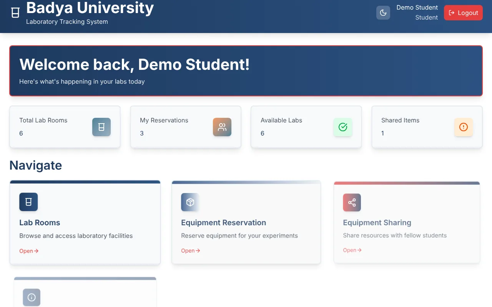
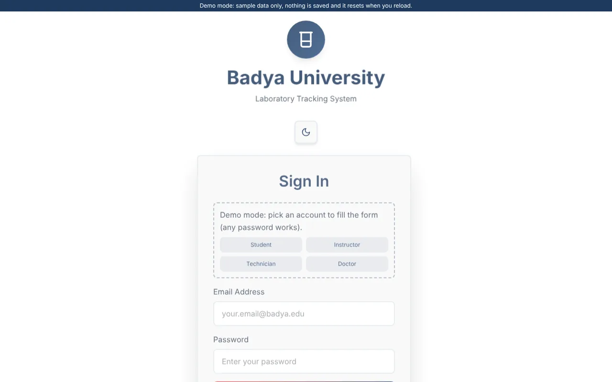
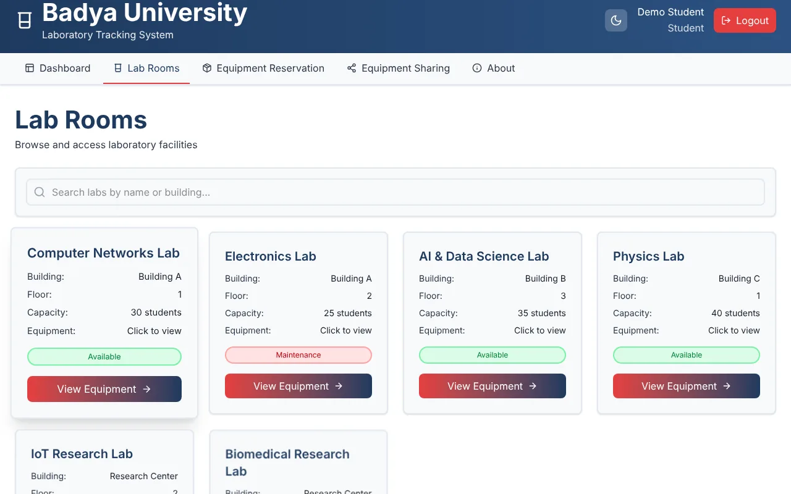
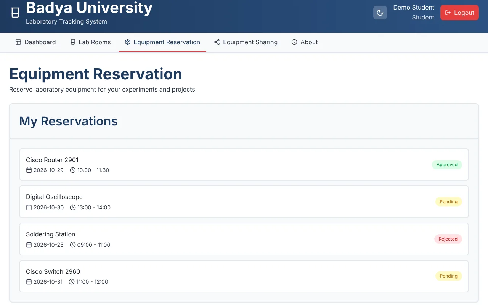
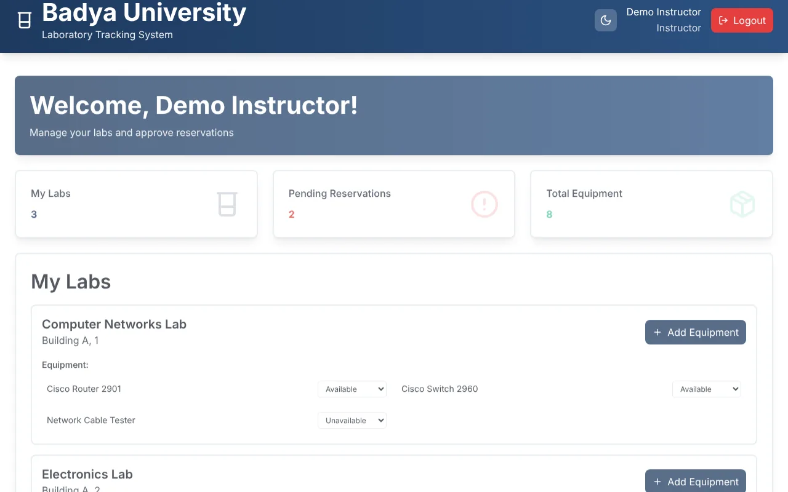
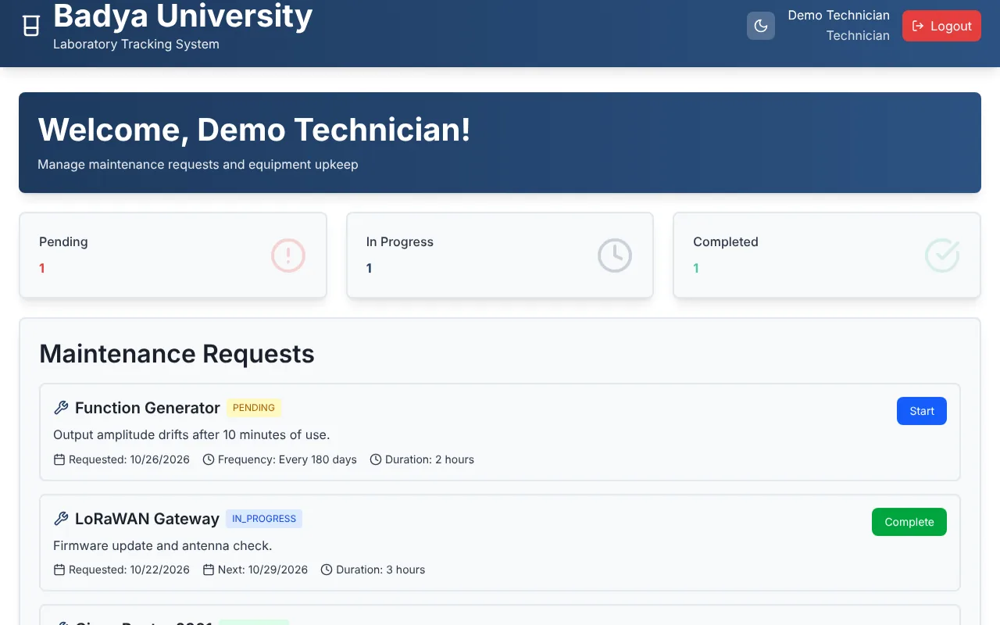

# BU-LabTrack

A web app for managing university labs at **Badya University**: browse lab rooms, reserve equipment, share tools between students, follow research labs, and handle approvals and maintenance. Built as a student team project.

> **This repository contains the React frontend.** It talks to a REST API (see [Backend](#backend)), and it also has a built-in **demo mode** with sample data, so you can try every screen without the backend.

**Live demo:** https://adham107harp.github.io/BU-LabTrack/ (sample data, no sign-up needed)



## Try it in 1 minute (demo mode)

```bash
npm install
npm run dev:demo   # http://localhost:3000
```

Click **Sign In**, then pick one of the demo accounts (student, instructor, technician, doctor). Any password works. Everything runs in the browser on sample data and resets when you reload the page.

## Roles

The app has four kinds of users, each with their own registration and dashboard:

| Role | What they can do |
|---|---|
| **Student** | View labs and equipment, reserve equipment, list and borrow shared tools, browse research labs |
| **Instructor** | Review reservations (approve / reject), add equipment, update equipment status |
| **Technician** | See and handle maintenance requests assigned to them |
| **Doctor** | View the research labs overview dashboard |

## Screenshots

| Login (demo mode) | Lab rooms |
|---|---|
|  |  |
| **Equipment reservations** | **Instructor dashboard** |
|  |  |
| **Technician maintenance** | |
|  | |

## Features

- Sign up and log in per role, JWT stored client-side and sent with every request
- Lab rooms and equipment listing, with availability checks before booking
- Equipment reservations with instructor approval workflow
- Student-to-student equipment sharing
- Research lab section
- Technician maintenance requests
- Dark mode

## Tech stack

- React 18 + TypeScript
- Vite 6
- Tailwind CSS 4 (compiled at build time with `@tailwindcss/vite`)
- shadcn/ui components on top of Radix UI
- Recharts, React Hook Form, Sonner (toasts), Lucide icons

## Running against the real API

```bash
npm install
cp .env.example .env   # set VITE_API_BASE_URL if your API is not on localhost:8080
npm run dev            # http://localhost:3000
npm run build          # production build in /build
```

| Script | What it does |
|---|---|
| `npm run dev` | Dev server, talks to the API |
| `npm run dev:demo` | Dev server on sample data, no API needed |
| `npm run build` | Production build in `/build` |
| `npm run build:demo` | Static demo build (relative paths, can be hosted on GitHub Pages or any static host) |

## Backend

The frontend calls these resources on `VITE_API_BASE_URL` (default `http://localhost:8080/api`):

`/auth/register*`, `/auth/login`, `/labs`, `/equipment`, `/reservations`, `/shared-tools`, `/research`, `/maintenance-requests`

The backend is a separate service and is not included here. In demo mode, `src/services/demoBackend.ts` answers the same endpoints with the same response shapes.

## Project structure

```
src/
├── components/             # screens per role + shared UI (ui/ = shadcn components)
├── services/api.ts         # typed API client and auth token helpers
├── services/demoBackend.ts # in-memory sample backend used by demo mode
├── App.tsx                 # view switching, auth state, dark mode context
└── styles/globals.css      # Tailwind entry point, theme colours, animations
```

## Credits

UI scaffolding was generated from a Figma design with Figma Make, then wired to the API. Components from [shadcn/ui](https://ui.shadcn.com/) (MIT) and photos from [Unsplash](https://unsplash.com). See `src/Attributions.md`.
